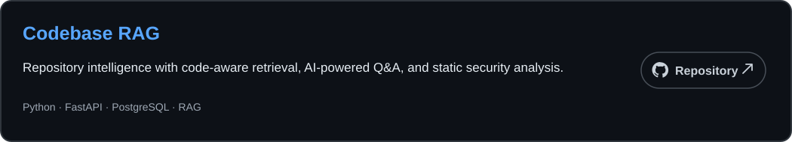
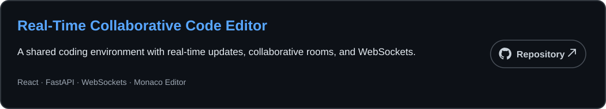
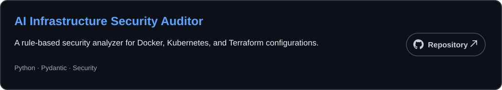

# Hey, I'm Shlok

**CS student @ VIT Vellore**

  
  &nbsp;&nbsp;
  
  &nbsp;&nbsp;
  

---

## What I'm building

  

  

  

---

## Tech Stack

Python · FastAPI · PostgreSQL · React · Docker · RAG · LLMs · Embeddings · WebSockets